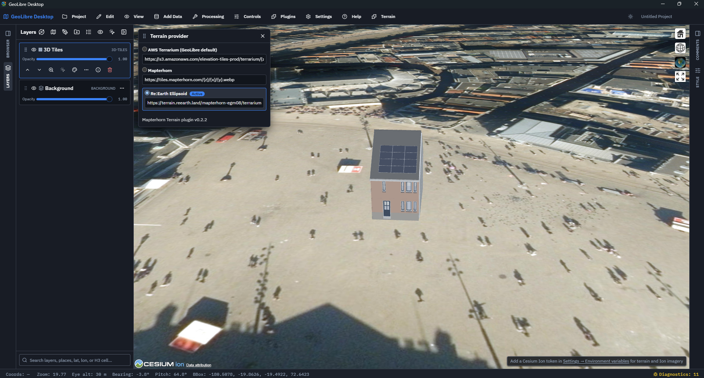

# GeoLibre Mapterhorn Terrain Plugin

A [GeoLibre](https://github.com/opengeos/GeoLibre) plugin that lets you choose the 3D terrain source: **AWS Terrarium** (GeoLibre default),
[Mapterhorn](https://mapterhorn.com/) or **Re:Earth Ellipsoid**. It works in all renderers (MapLibre, Mapbox and Cesium).

GeoLibre Plugin: https://plugins.geolibre.app/catalog/geolibre-mapterhorn/


## How it works in GeoLibre

1. **First enable 3D terrain** in GeoLibre: check **Controls → Terrain**.
2. **Then pick the terrain source** in the plugin, via the **Terrain** toolbar menu (**Use AWS Terrarium (GeoLibre default)**, **Use Mapterhorn**, **Use Re:Earth Ellipsoid**) or the **Terrain provider…** panel.

Terrain exaggeration can be adjusted by double-clicking the GeoLibre terrain button.

## Providers

All three use Terrarium encoding. The URL of each provider is editable in the panel (`{z}`, `{x}`, `{y}` placeholders); the selected provider and URLs are saved in the GeoLibre project file.

| Provider | Default URL | Tile size | Max zoom |
| --- | --- | --- | --- |
| AWS Terrarium (default, GeoLibre's own terrain) | `https://s3.amazonaws.com/elevation-tiles-prod/terrarium/{z}/{x}/{y}.png` | 256 | 15 |
| Mapterhorn | `https://tiles.mapterhorn.com/{z}/{x}/{y}.webp` | 512 | 17 |
| Re:Earth Ellipsoid | `https://terrain.reearth.land/mapterhorn-egm08/terrarium/ellipsoid/{z}/{x}/{y}.webp` | 512 | 14 |

Note: the Re:Earth default URL serves **ellipsoidal heights** (WGS84, `/terrarium/ellipsoid/`; sea-level variant: `/terrarium/elevation/`), which is what Cesium expects, so ellipsoidal 3D tilesets (e.g. 3D BAG) sit on the terrain. AWS and Mapterhorn serve heights above sea level (geoid); tilesets in ellipsoidal heights float above them by the geoid undulation (about 45 m in the Netherlands).

## Demo: building on the Dam (Amsterdam)

Add this 3D Tiles layer in GeoLibre with the **Cesium** renderer:

`https://bertt.github.io/cesium_3dtiles_samples/samples/b3dm/tileset45.json`

Select **Re:Earth Ellipsoid** in the plugin: the tileset uses ellipsoidal heights (the Dam is 45.6 m above the ellipsoid), so with Re:Earth Ellipsoid terrain the building sits on the ground. With AWS or Mapterhorn (heights above sea level) it floats about 45 m above the terrain.



## Renderer support

| Renderer | Status |
| --- | --- |
| MapLibre | Supported |
| Mapbox | Supported |
| Cesium | Supported (Terrarium heightmap provider) |
| ArcGIS | Not supported |

On unsupported renderers GeoLibre suspends the plugin. Disabling the plugin restores the AWS default on MapLibre/Mapbox.
## Install

Requires GeoLibre 0.9.0 or newer.

- **From the plugin registry** (once published in [geolibre-plugins](https://github.com/opengeos/geolibre-plugins)):
  open **Plugins → Manage Plugins…**, find *Mapterhorn Terrain* and install it.
- **From a zip file:** download `geolibre-mapterhorn-<version>.zip` from the
  [Releases](https://github.com/bertt/geolibre-mapterhorn-plugin/releases) page, then use
  **Manage Plugins → Settings → Install from file**.
- **For development:** build the plugin (below) and add the `dist/geolibre-mapterhorn` folder under
  **Settings → Plugins** as a development directory.

## Build

Requires Node.js 18+.

```bash
npm install
npm run build            # dist/geolibre-mapterhorn/{plugin.json,index.js,style.css}
npm run package:geolibre # also creates dist/geolibre-mapterhorn-<version>.zip and prints its SHA-256
```

## Creating a release

1. Bump the version in `geolibre-plugin/plugin.json` (the build and zip name use this) and in `package.json`.
2. Build and package:
   ```bash
   npm run package:geolibre
   ```
   This creates `dist/geolibre-mapterhorn-<version>.zip` and `.zip.sha256`, and prints the SHA-256.
3. Commit, tag and push:
   ```bash
   git commit -am "Release v<version>"
   git tag v<version>
   git push && git push --tags
   ```
4. Create the GitHub release and attach the zip and checksum:
   ```bash
   gh release create v<version> dist/geolibre-mapterhorn-<version>.zip dist/geolibre-mapterhorn-<version>.zip.sha256 --generate-notes
   ```
5. To publish in the plugin registry, update the entry (download URL and SHA-256) in
   [geolibre-plugins](https://github.com/opengeos/geolibre-plugins).

## Credits

Terrain data: [Mapterhorn](https://mapterhorn.com/). Default GeoLibre terrain:
[AWS Open Data Terrain Tiles](https://registry.opendata.aws/terrain-tiles/).

## License

MIT
